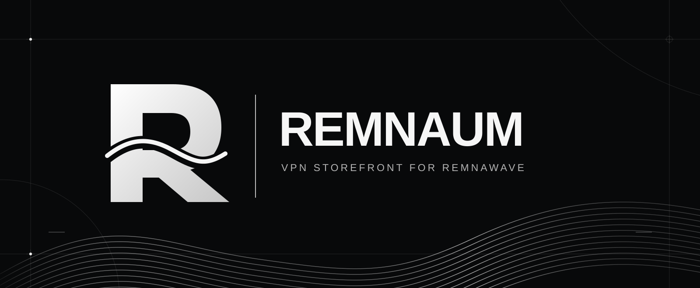

<div align="center">



# Remnaum

**VPN-магазин на базе [Remnawave](https://github.com/remnawave/panel).**

Telegram-бот · Mini App · Браузерный кабинет · Админ-панель

[](LICENSE) [](requirements.txt) [](compose.yaml)

[Установка](#установка) · [Возможности](#возможности) · [Инструкция](docs/INSTALL.md)

</div>

## Возможности

| Покупателям | Администратору |
| --- | --- |
| Тарифы, оплата, продление и управление устройствами | Клиенты, платежи, тарифы и Internal Squads |
| Mini App и кабинет в браузере с входом через Telegram или Google | Общая палитра, логотип и баннер магазина |
| Пробный доступ, промокоды и приглашения | Рассылки, обязательный канал и лимиты устройств |
| Прямой контакт и тикеты с историей | Ответы на тикеты и уведомления с кнопкой перехода |

Оплата поддерживает Telegram Stars, ЮKassa, ЮMoney, Crypto Pay и Platega. Для работы нужна действующая панель Remnawave с API-токеном.

## Установка

Понадобятся VPS с Ubuntu/Debian и доступом `sudo`, Telegram-бот и три DNS-адреса. Мастер предлагает `miniapp.ваш-домен` для Telegram и `web.ваш-домен` для браузера на основе адреса `webhook.ваш-домен`.

```bash
git clone https://github.com/u988m/remnaum.git
cd remnaum
sudo sh install.sh
```

Поддерживается установка рядом с Remnawave и на отдельном VPS. После установки откройте Mini App → «Профиль» → «Админ-панель». Для обновлений и резервных копий используйте `sudo remnaum`.

[Инструкция по установке и обновлению](docs/INSTALL.md) · [GitHub Releases](https://github.com/u988m/remnaum/releases) · [Лицензия MIT](LICENSE)

## Сообщество

<table align="center">
  <tr>
    <td align="center"><a href="https://t.me/remnaum/6"></a></td>
    <td align="center"><a href="https://t.me/remnaum/3"></a></td>
    <td align="center"><a href="https://t.me/remnaum/5"></a></td>
  </tr>
</table>
