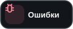

<div align="center">


# Remnaum

**Открытый конструктор VPN-магазина на базе [Remnawave](https://github.com/remnawave/panel).**

Telegram-бот · Mini App · Веб-магазин · Админ-панель

[](LICENSE) [](requirements.txt) [](compose.yaml)

**[Установить](#-установка) · [Возможности](#-возможности) · [Подробная инструкция](docs/INSTALL.md)**

</div>

## Что такое Remnaum?

**Remnaum** помогает владельцу Remnawave запустить свой VPN-магазин без разработки отдельного бота и сайта.

Покупатели выбирают тариф, оплачивают подписку и получают ссылку для подключения. Владелец управляет тарифами, клиентами и платежами через админ-панель.

> Remnaum — **не VPN-сервер и не замена Remnawave**. Для работы нужна установленная панель Remnawave с доступом к API.

## 📱 Как выглядит


*Реальный интерфейс Remnaum: главная страница, устройства и панель управления.*

## ✨ Возможности

| Для покупателей | Для владельца |
| --- | --- |
| Telegram-бот, Mini App и веб-магазин | Управление тарифами и Internal Squads |
| Покупка и продление VPN | Клиенты, подписки и статистика |
| Подключение и управление устройствами | Настройки магазина и способы оплаты |
| Пробный доступ, промокоды и рефералы | Резервные копии и обновления |

**Оплата:** Telegram Stars, YooKassa, YooMoney, Crypto Pay и Platega. Владелец самостоятельно подключает нужные методы; для внешних систем требуются реквизиты. Реальные платежи необходимо проверить перед запуском продаж.

## 🚀 Установка

Понадобятся **VPS с Ubuntu/Debian**, домен с двумя поддоменами, Telegram-бот от [@BotFather](https://t.me/BotFather) и работающая панель Remnawave с API-токеном.

```bash
git clone https://github.com/u988m/remnaum.git
cd remnaum
sudo sh install.sh
```

Мастер проведёт через настройку. Можно установить Remnaum **на одном сервере с Remnawave** или **на отдельном VPS**.

После установки откройте бота, перейдите в Mini App → **Профиль → Админ-панель** и настройте магазин и тарифы.

**[Подробная пошаговая инструкция →](docs/INSTALL.md)**

## ⚙️ Управление

После установки откройте меню обновлений и резервных копий:

```bash
sudo remnaum
```

## 🔗 Полезные ссылки

[Инструкция](docs/INSTALL.md) · [История изменений](CHANGELOG.md) · [Лицензия MIT](LICENSE) · [GitHub Releases](https://github.com/u988m/remnaum/releases)

## 💬 Связь с нами

<table align="center">
  <tr>
    <td align="center"><a href="https://t.me/remnaum/6"></a></td>
    <td align="center"><a href="https://t.me/remnaum/3"></a></td>
    <td align="center"><a href="https://t.me/remnaum/5"></a></td>
  </tr>
</table>

<div align="center">

**Remnaum · Open Source · MIT**

</div>
