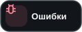
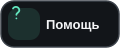

# 📖 Пошаговая установка Remnaum

[← Вернуться к Remnaum](../README.md) · [Решение проблем](#если-что-то-не-работает) · [Помощь](#-помощь-и-сообщество)

**Remnaum** — магазин VPN-подписок для уже работающей панели Remnawave. Устанавливается **рядом с панелью** или **на отдельный VPS**. В обоих случаях нужен доступ к API Remnawave.

> **Это инструкция для Ubuntu/Debian.** Все команды выполняйте на сервере, где будет установлен Remnaum. Если Remnawave работает отдельно, устанавливайте Remnaum на выбранный для магазина VPS.

## ✅ Шаг 1. Подготовьте всё необходимое

| Что нужно | Где взять |
| --- | --- |
| VPS с Ubuntu/Debian и доступом `sudo` | Ваш хостинг |
| Работающая панель Remnawave | Собственная установка Remnawave |
| HTTPS-адрес API и API-токен Remnawave | Настройки вашей панели |
| Telegram-бот и его токен | [@BotFather](https://t.me/BotFather) |
| Числовой Telegram ID владельца | Ваш Telegram-аккаунт |
| Два поддомена | DNS вашего домена |
| Email для HTTPS-сертификатов | Для отдельного VPS |

**Пример поддоменов** (замените на свои):

- `webhook.example.com` — уведомления Telegram, Remnawave и платежей;
- `miniapp.example.com` — Mini App, сайт магазина и админ-панель.

Укажите для обоих поддоменов **A-запись с IP сервера Remnaum**. Запись AAAA добавляйте только при настроенном IPv6. Адрес панели Remnawave должен быть другим.

**Важно:** домены магазина в мастере вводятся **без** `https://`, а API-адрес Remnawave — **с** `https://`.

## 📥 Шаг 2. Скачайте Remnaum

Подключитесь к серверу через SSH и выполните:

```bash
git clone https://github.com/u988m/remnaum.git
cd remnaum
sudo sh install.sh
```

Если Git или Python 3 отсутствуют, установите их средствами Ubuntu/Debian. Установщик также проверит наличие Python 3.

**Альтернативный способ для нового VPS** — мастер скачивания в одну команду:

```bash
curl -fsSL https://raw.githubusercontent.com/u988m/remnaum/main/bootstrap.sh | sudo sh
```

Используйте **один** из двух вариантов, а не оба подряд. Для работы мастера нужен интерактивный терминал.

## 🖥️ Шаг 3. Выберите, где работает магазин

В мастере выберите один из режимов:

| Вместе с Remnawave | На отдельном VPS |
| --- | --- |
| Установка на сервер с панелью | Установка на другой сервер |
| Использует существующий Caddy/Nginx | Мастер настраивает Caddy |
| Не занимает порты панели 80/443 | Нужны доступные 80/443 |
| Может предложить безопасную настройку локальных вебхуков | Подключается к удалённой панели через API |

Мастер проверит Docker, порты, запросит домены, Telegram-данные и API-токен Remnawave. Пароль PostgreSQL можно задать или сгенерировать автоматически.

Если сервер уже используется, **не заменяйте конфигурацию прокси панели вручную** — подробности для каждого режима приведены [ниже](#-варианты-установки-подробности).

## 🔗 Шаг 4. Подключите Telegram и Remnawave

1. В мастере укажите токен бота, Telegram ID администратора и API Remnawave.
2. Убедитесь, что публичные HTTPS-адреса магазина работают.
3. Для Mini App откройте [@BotFather](https://t.me/BotFather) и укажите адрес `https://miniapp.example.com`.
4. Вебхук Remnawave на **том же сервере** мастер может предложить настроить с сохранением существующих получателей. Для **удалённой панели** вебхук и общий секрет необходимо настроить на стороне панели отдельно.

Адрес вебхука Remnawave: `https://webhook.example.com/webhooks/remnawave`. Не публикуйте секреты и токены. [Настройка удалённого вебхука →](#вебхук-remnawave)

## 🛍️ Шаг 5. Настройте магазин

1. Откройте Telegram-бота и отправьте `/start`.
2. С аккаунта владельца откройте **Mini App → Профиль → Админ-панель**.
3. Укажите название, оформление и поддержку.
4. Создайте тарифы: срок, трафик, устройства, цены и **Internal Squads** Remnawave.
5. В **Настройки → Платёжные системы** включите нужные способы оплаты, задайте реквизиты и уведомления.
6. При необходимости включите пробный доступ, промокоды и рефералов.

Покупатели могут выбирать только те тарифы и опции, которые настроил владелец.

## 🧪 Шаг 6. Проверьте запуск

Проверьте адреса, подставив свой домен:

| Адрес | Что проверить |
| --- | --- |
| `https://miniapp.example.com` | Mini App открывается |
| `https://miniapp.example.com/store` | Веб-магазин доступен |
| `https://miniapp.example.com/admin` | Владелец может войти |
| `https://miniapp.example.com/health` | API отвечает |

Затем сделайте **тестовую покупку**: платёж должен подтверждаться сервером, подписка — появляться в Remnawave, а ссылка — открываться в VPN-клиенте. До такой проверки не принимайте реальные платежи.

## 💾 Шаг 7. Сохраните доступ для обновлений и восстановления

После установки меню можно открыть из любой папки:

```bash
sudo remnaum
```

Через него доступны обновление, резервные копии и восстановление. **Сохраните ключ восстановления отдельно от сервера**: без него расшифровать резервную копию на другом VPS нельзя.

> Не публикуйте `.env`, токены, `APP_SECRET_KEY` и ключ резервного копирования. Не выполняйте `docker compose down -v` и `docker volume prune` для «исправления» ошибок — так можно удалить данные.

---

# Дополнительные настройки и решение проблем

Первых семи шагов достаточно для основного сценария. Далее — подробные инструкции по двум режимам размещения, вебхукам, резервным копиям, обновлениям и диагностике.

## 🖥️ Варианты установки: подробности

| Параметр | Рядом с Remnawave | Отдельный VPS |
| --- | --- | --- |
| Выбор мастера | `panel` | `standalone` |
| Порты 80 и 443 | Остаются у существующего прокси | Использует Caddy |
| Приложение | `127.0.0.1:18080` и Docker-сеть | Внутри Docker |
| HTTPS | Через текущий Caddy/Nginx | Caddy настраивает автоматически |

### 1. Рядом с Remnawave

Выберите **«На сервере с Remnawave»**. Установщик не заменяет панель и не забирает у неё порты 80/443.

Для стандартной конфигурации Caddy мастер может предложить добавить два новых домена. Перед изменением он делает **резервную копию**, проверяет конфигурацию и при ошибке восстанавливает прежнюю.

Если панель установлена по официальной инструкции в `/opt/remnawave`, мастер **сам определит её адрес** из `FRONT_END_DOMAIN`, найдёт `.env`, возьмёт существующий секрет вебхука, **сохранит прежние адреса вебхуков**, добавит адрес Remnaum и предложит применить изменения. Перед обновлением панели создаётся резервная копия; перезапускается **только** сервис `remnawave`, не её PostgreSQL или Redis. Изменения включаются только после успешной проверки HTTPS на публичном домене магазина. Если адрес API указывает на другую панель или настройки отличаются от типовых, ничего чужого не перезаписывается.

Если ваш прокси настроен нестандартно, установщик создаст готовые примеры в `generated/`. Выберите подходящий файл:

- `remnaum.docker.caddy` или `remnaum.docker.nginx.conf` — прокси в Docker и общей сети с приложением.
- `remnaum.host.caddy` или `remnaum.host.nginx.conf` — прокси непосредственно на сервере.

Пример для Caddy в Docker-сети `remnawave-network`:

```caddyfile
https://webhook.example.com, https://miniapp.example.com {
    encode zstd gzip
    reverse_proxy http://remnaum-api:8080
}
```

Добавляйте **отдельный блок сайта**, а не заменяйте конфигурацию панели. Для прокси, установленного прямо на сервере, используется `http://127.0.0.1:18080`.

Если нужной общей сети нет, проверьте `docker network ls`. Режим можно выбрать вручную:

```bash
sudo sh install.sh --mode panel --proxy-network ИМЯ_СЕТИ
```

### 2. На отдельном VPS

Выберите **«На отдельном сервере»**. Мастер развернёт Caddy → Nginx → приложение, а также PostgreSQL и Redis. Публичные порты 80/443 принадлежат Caddy; другие сервисы остаются во внутренней сети Docker.

Проверьте, что DNS направлен на этот VPS, а **80/TCP и 443/TCP** разрешены межсетевым экраном. Для HTTP/3 дополнительно используется 443/UDP. Панель Remnawave при этом может работать на другом сервере.

Если 80/443 заняты, мастер предложит совместное использование существующего прокси вместо остановки других служб.

## ⚙️ Настройка после установки

### Telegram и оформление магазина

Откройте [@BotFather](https://t.me/BotFather), выберите вашего бота и укажите URL Mini App:

```text
https://miniapp.example.com
```

Для внешнего сайта `/store` отдельно настройте домен входа через Telegram Login Widget в BotFather.

Запустите бота командой `/start`. Установщик автоматически получает **username и отображаемое имя бота** через BotFather API по введённому токену. С аккаунта администратора откройте **Mini App → Профиль → Админ-панель**.

В боковом меню админки откройте **Оформление**, чтобы изменить название, слоган, описание и общую палитру магазина. Прямой контакт задаётся в разделе **Поддержка**. Можно загрузить логотип для Mini App и баннер для Mini App и приветствия бота. JPG, PNG и WebP до 5 МБ хранятся в `data/branding/`, сохраняются при обновлении и входят в резервную копию.

В разделе **Тарифы** настройте срок, трафик, устройства, цены, сортировку и Internal Squads. Значение трафика **0** означает безлимит. Цена в рублях равна базовой цене плюс цена за устройство, умноженная на выбранное количество дополнительных устройств. Пустая цена доп. устройства отключает их продажу, а явный ноль разрешает добавление бесплатно. Суммарное количество ограничено `TARIFF_MAX_DEVICES`. Для оплаты заказа с доп. устройствами в Telegram Stars укажите отдельную цену за устройство в Stars.

Готовые тарифы доступны в **Mini App → Профиль → Все тарифы**. Параметры и состав сквадов фиксируются в заказе при создании счёта. После миграции `0002_tariff_plan_options` существующие тарифы сохраняют цену и доступ, а доп. устройства выключены до настройки. Названия и порядок способов оплаты меняются в **Настройки → Платёжные системы**. Первый доступный способ выбран при открытии заказа.

### Вебхук Remnawave

**На сервере с панелью** мастер сам предложит синхронизировать исходящий вебхук. Он использует существующий секрет, если тот корректен, и не удаляет другие получатели событий.

**Если панель находится на другом сервере**, её секреты нельзя прочитать через обычный API-токен: они находятся в `.env` удалённого сервера. Поэтому удалённый вебхук нужно указать один раз на сервере панели. URL мастер формирует автоматически:

```text
https://webhook.example.com/webhooks/remnawave
```

Секрет должен совпадать с `REMNAWAVE_WEBHOOK_SECRET` установленного Remnaum. Для удалённой панели укажите тот же секрет в переменной `WEBHOOK_SECRET_HEADER` её `.env`; остальные уже настроенные URL не удаляйте. После редактирования примените конфигурацию панели по её инструкции. Конкретные поля вебхука зависят от версии панели. Telegram webhook использует `https://webhook.example.com/telegram/webhook`.

### Магазин и оплата

В админке настройте название, оформление, поддержку, условия продажи, тарифы, цены, платёжные системы, промокоды, пробный доступ и реферальные бонусы. **Реквизиты платёжных провайдеров хранятся в зашифрованной БД**, а не в README.

| Адрес | Назначение |
| --- | --- |
| `https://miniapp.example.com` | Mini App |
| `https://miniapp.example.com/store` | Веб-магазин |
| `https://miniapp.example.com/admin` | Админка |
| `https://miniapp.example.com/health` | Проверка API |

## 💾 Полные резервные копии и восстановление

После установки команда **`remnaum`** работает из любой директории:

```bash
remnaum
```

Выберите **3 — Резервные копии и восстановление**. Доступны создание архива, восстановление, настройка расписания и список сохранённых копий.

**В архив входит** конфигурация `.env`, PostgreSQL (включая тарифы, оплаты, рефералов, брендинг и ключи провайдеров), Redis, файлы приложения, данные и настройки расписания. Система шифрует архив AES-256 с PBKDF2 и проверяет его целостность по HMAC-SHA256. По умолчанию файлы хранятся в `/opt/remnaum/backups/`.

Во время первой установки можно **указать собственный ключ восстановления** (не менее 24 символов) или принять автоматически сгенерированный. **Сохраните ключ отдельно от сервера:** он не вложен в архив и не отправляется в Telegram. Без него восстановить копию на другом VPS невозможно.

### Автоматические копии

В пункте 3 → **Настроить расписание** выберите:

- **Каждый час** или **каждый день**; либо отключите расписание.
- Сколько последних локальных архивов хранить (1–365).
- Отправлять ли архив в Telegram, и ID получателя. Перед отправкой получатель должен начать диалог с вашим ботом через `/start`.

Планировщик использует systemd. В Telegram отправляется **только зашифрованный `.rmb`**; если файл больше допустимого размера для Bot API или Telegram недоступен, он всё равно сохраняется локально.

```bash
systemctl status remnaum-backup.timer
```

### Восстановление на другом сервере

1. Запустите установку Remnaum одной командой и укажите прежнюю папку (если хотите сохранить исходное расположение).
2. Откройте `remnaum` → **3 — Резервные копии и восстановление** → **Восстановить архив**.
3. Укажите путь к скачанному файлу `.rmb` и сохранённый ключ восстановления.
4. Мастер проверит архив, покажет исходный путь установки, запросит подтверждение, восстановит базу, файлы и настройки и запустит контейнеры.

При восстановлении действующего магазина мастер сначала создаст дополнительную аварийную копию. DNS и настройки **чужой панели Remnawave** не перезаписываются, а сертификаты Caddy на новом сервере будут получены заново.

Если запускаете восстановление действующего магазина через `scripts/backup_manager.py restore`, сначала создайте отдельную аварийную копию командой `sudo bash backup.sh`. При сбое PostgreSQL или Redis приложение может остаться остановленным. Устраните причину и повторите восстановление либо верните аварийную копию до запуска магазина. PostgreSQL восстанавливается одной транзакцией. Файлы установки и Redis обновляются отдельно.

Перед распаковкой Remnaum проверяет структуру архива и свободное место во временном каталоге. По умолчанию допускается **16 ГиБ на файл**, **64 ГиБ суммарно** и **250 000 путей**, включая каталоги, подразумеваемые путями файлов. Максимальная вложенность — 128 компонентов пути. Эти пределы относятся к распакованным данным и не меняют формат V1. Если проверенный архив большого магазина превышает их, задайте только необходимые пределы для одного запуска, исходя из размеров дампа, всех файлов и объёма свободного места. Учитывайте место под временную копию расшифрованного архива и под восстановление PostgreSQL и Redis.

Например, чтобы разрешить файл до 32 ГиБ и общий объём до 96 ГиБ:

```bash
sudo env REMNAUM_RESTORE_MAX_FILE_BYTES=34359738368 REMNAUM_RESTORE_MAX_TOTAL_BYTES=103079215104 remnaum
```

Лимиты размеров задаются в байтах. Для количества путей используйте `REMNAUM_RESTORE_MAX_PATHS`. При необходимости задайте `TMPDIR` с приватным каталогом на диске достаточного объёма тем же способом.


### Миграции схемы БД

При запуске Remnaum последовательно применяет версионированные миграции Alembic под блокировкой PostgreSQL. Начальная ревизия `0001_legacy_baseline` сохраняет существующие данные и переносит применявшиеся ранее изменения схемы. Версия хранится в таблице `alembic_version`. Перед обновлением обязательно создайте и проверьте зашифрованную резервную копию. Не удаляйте таблицу `alembic_version` вручную и не используйте downgrade для базовой ревизии: откат данных выполняется восстановлением резервной копии.

### Создать копию командой

```bash
cd /opt/remnaum
sudo bash backup.sh
```

> Резервная копия Remnaum не включает базу удалённой панели Remnawave или конфигурацию её прокси. После переноса на другой VPS проверьте DNS и подключение к панели.

## 🔄 Обновление и обслуживание

Каталог обновляется при запуске, каждые 15 минут и по кнопке «Обновить список сквадов». При сбое остаётся последний успешный список. Удалённый сквад останется в настройках тарифа с предупреждением. Для новых продаж замените его доступным.

Состав готового тарифа фиксируется при оформлении платежа. Продление того же тарифа сохраняет фактические назначения панели. Оплаченная смена тарифа применяет сквады из платежа после проверки их доступности. При сбое заказ остаётся оплаченным для повторной выдачи. Если аккаунт удалён в Remnawave, магазин не создаёт новый счёт для этой подписки. Если удаление произошло после оплаты, заказ остаётся оплаченным. Выдача возобновится после восстановления исходного аккаунта и повторной обработки. Для старой подписки без подтверждённого тарифа при следующей покупке нужен доступный набор сквадов. При переходе с пробного доступа на готовый тариф применяются сквады покупки. При миграции старые готовые тарифы получают копию прежнего списка UUID из конфигурации. Если он был пуст, выберите сквады перед первой продажей. В разделе «Тарифы → Доступ по режимам» отдельно укажите сквады гибкого конструктора и пробного доступа. При обновлении эти настройки однократно получают прежние UUID. При пустой настройке первичная выдача по этим режимам недоступна.

Если использовали стандартный путь установки:

```bash
cd /opt/remnaum
sudo sh install.sh
```

В меню выберите **«2 — Обновить»**. Вызвать то же меню из любой папки можно командой **`remnaum`**. Перед обновлением мастер создаст резервную копию БД, затем обновит код и контейнеры. При нестандартном пути перейдите в выбранную вами папку.

### Повторная установка после удаления папки

**Удаление каталога Remnaum не удаляет Docker volumes.** PostgreSQL может сохранить базу и старый пароль роли, даже если проект был скачан заново. Случайный пароль из новой `.env` не меняет пароль в существующей базе.

Теперь при установке мастер **до запуска приложения** отдельно проверяет подключение к PostgreSQL. Если найден конфликт пароля, он объяснит ситуацию и предложит **только после явного согласия** синхронизировать пароль роли с новым `.env`. Пользовательские таблицы и Docker volumes не удаляются. При ошибке проверки новый пароль откатывается к прежнему verifier роли. Не используйте `docker compose down -v` или `docker volume prune` для исправления этой проблемы.

Если вы восстанавливаете *действующий магазин*, одного восстановления доступа к PostgreSQL недостаточно: для расшифровки ранее сохранённых реквизитов и настроек может понадобиться **исходный APP_SECRET_KEY и резервная копия**. Сначала проверьте наличие исходных секретов и бэкапа. Если установка уже остановилась на ошибке аутентификации, откройте `sudo remnaum` и выберите **«4 — Сменить пароль PostgreSQL»**; этот пункт работает и при неработающем API.

### PostgreSQL отклоняет пароль при обновлении

Перед заменой приложения обновление проверяет подключение с `DATABASE_URL` из конфигурации нового контейнера. Если PostgreSQL отклоняет пароль, прежний контейнер и резервная копия сохраняются. Отметка `Healthy` у PostgreSQL показывает, что сервер принимает подключения, и сама по себе не подтверждает пароль приложения.

Для штатного PostgreSQL откройте `sudo remnaum` и выберите **«4 — Сменить пароль PostgreSQL»**. Введите и подтвердите новый пароль из 12–128 символов. Допустимы латинские буквы, цифры и `. _ ~ -`. Мастер изменит пароль роли в существующей базе, обновит `POSTGRES_PASSWORD` и `DATABASE_URL`, проверит подключение и перезапустит приложение. При ошибке проверки он восстановит прежний пароль роли и `.env`. Для внешнего PostgreSQL смену пароля выполняет администратор базы.

Ключ восстановления нужен для расшифровки резервных копий. Минимальная длина пользовательского ключа составляет 24 символа. Если при обновлении старой установки ключа ещё нет, интерактивное обновление сгенерирует его один раз. Сохраните ключ отдельно от сервера. Следующие обновления используют сохранённый ключ.


Полезные команды:

```bash
docker compose ps
docker compose logs --tail=100 app
bash backup.sh
```

На сервере с панелью проверьте локальный API:

```bash
curl http://127.0.0.1:18080/health
```

Если мастер автоматически выбрал другой локальный порт, используйте его вместо `18080`.

Уведомления о новых коммитах в `main` проверяет системный таймер раз в 6 часов. Состояние таймера:

```bash
systemctl status remnaum-update-check.timer
```

### Если что-то не работает

| Симптом | Что проверить |
| --- | --- |
| Домен не открывается | DNS, HTTPS, настройки существующего прокси или логи Caddy |
| Ошибка 502 | Доступность FastAPI и правильный адрес проксирования |
| Бот не отвечает | Токен, Telegram webhook и `docker compose logs --tail=100 app` |
| Mini App пустой | HTTPS, домен Mini App, настройки BotFather |
| Не создаётся VPN | API-токен Remnawave, UUID групп, подтверждение платежа |

**Не запускайте** `docker compose down -v` на работающем магазине — эта команда удаляет тома данных. Не публикуйте содержимое `.env` и секреты из логов.


## 💬 Помощь и сообщество

<p align="center"><strong>Обновления, предложения, вопросы и сообщения об ошибках</strong></p>

<table align="center">
  <tr>
    <td align="center"><a href="https://t.me/remnaum/3"></a></td>
    <td align="center"><a href="https://t.me/remnaum/4"></a></td>
  </tr>
  <tr>
    <td align="center"><a href="https://t.me/remnaum/5"></a></td>
    <td align="center"><a href="https://t.me/remnaum/6"></a></td>
  </tr>
</table>

[← Вернуться в README](../README.md)

## Веб-вход, проверка канала и операции бота

Веб-приложение открывается на корне `WEBAPP_DOMAIN`. Ранее выданные ссылки
на `/app` продолжают открываться. Для браузерного входа Telegram привяжите
этот домен к боту через BotFather (`/setdomain`).

В админке откройте «Настройки» → «Интеграции и лимиты». Для Google создайте
OAuth-клиент типа Web application и добавьте показанный в форме Redirect URI.
Войдите через Telegram в браузере и выберите «Привязать Google» в профиле.
После привязки Google открывает тот же профиль с покупками и подпиской.
Вход в админку подтверждается через Telegram.

Для обязательной подписки добавьте бота в администраторы канала и сохраните ID
канала или его @username вместе со ссылкой для вступления. Telegram доставляет
события об отписке через polling или webhook. Доступ к функциям магазина
проверяется по текущему статусу участника.

В этой же форме можно изменить подключение Remnawave и указать максимум
дополнительных устройств на заказ (от 0 до 1000). Для нового URL нужен токен
этой панели. Оставьте поля секретов пустыми, чтобы сохранить текущие значения.
Если меняете секрет вебхука, укажите то же значение на стороне Remnawave.

В «Рассылках и меню» можно отправить текст или обновить отслеживаемое меню
`/start` у доступных пользователей. Бот пришлёт итог в Telegram. Удаление
прежнего сообщения зависит от ограничений Telegram. Если удалить меню уже
нельзя, бот попробует убрать его кнопки.

В боковом меню админки откройте «Оформление», чтобы настроить общую палитру
Mini App, витрины и админки. Изменения публикуются кнопкой «Применить цвета».

В «Поддержке» админ задаёт прямой контакт и ведёт переписку по тикетам.
Историю можно фильтровать по статусу и искать по номеру или теме. Админ
и владелец тикета могут закрыть его или открыть снова. Уведомления в Telegram
содержат номер и кнопку перехода к конкретному тикету на настроенном HTTPS-домене Mini App.
